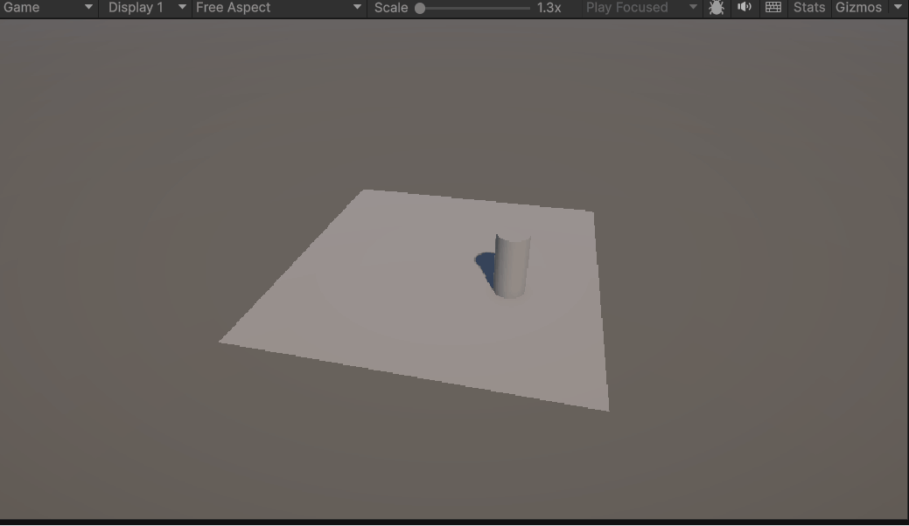
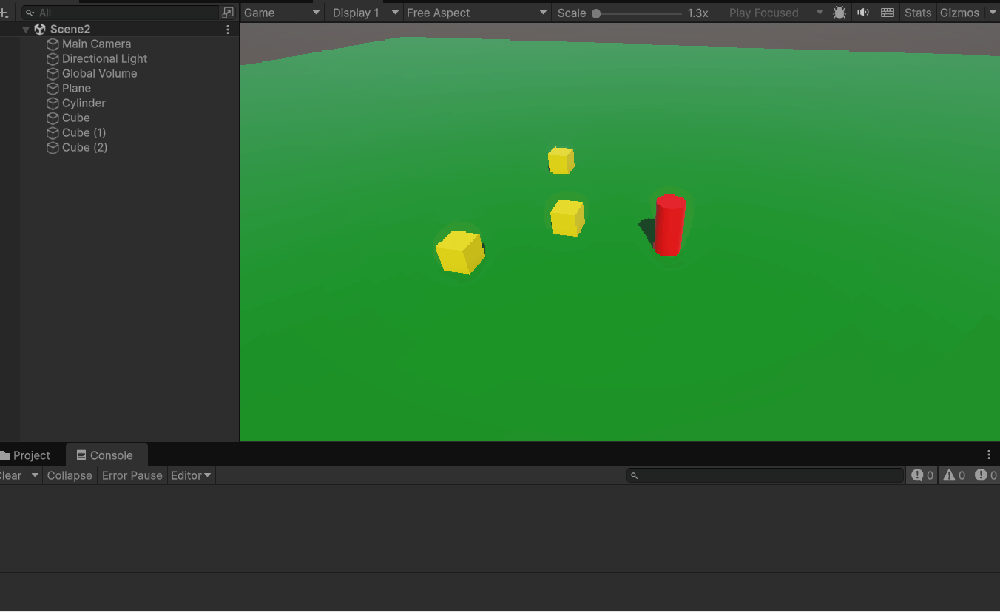
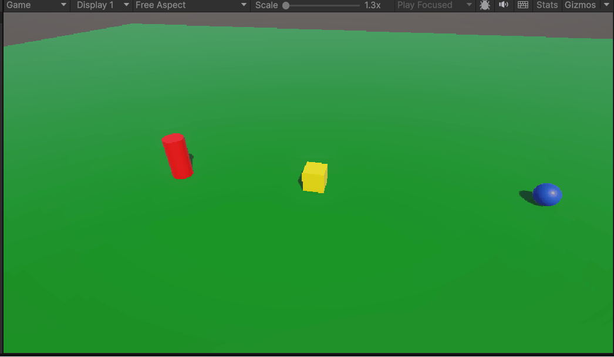

# Físicas 3D
## Ejercicio 1: experimentar con las físicas
### Situación 1
> El plano no es un objeto físico. El cubo es un objeto físico y la esfera no. En este caso, el plano y la esfera sólo tendrán collider, mientras que el cubo debe tener Rigidbody. 

Como el plano no es un objeto físico, no es afectado por la gravedad, al igual que la esfera. En el caso del cubo, este cae pero es sujetado por el plano al no tener la configuración de Trigger. Tanto el plano como la esfera tienen colisiones estáticas al no ser físicos, mientras que el cubo tiene una colisión dinámica. Según la documentación de Unity, ocurre la colisión y se notifica.

### Situación 2
> El plano no es un objeto físico. El cubo es un objeto físico y la esfera también. En este caso, el plano sólo tendrán collider, mientras que el cubo y la esfera deben tener Rigidbody. 

En este caso, al añadirle físicas a la esfera, esta cae por acción de la gravedad, colisiona con el cubo y sale del plano, cayendo al vacío. El plano sería el único con colisión estática, mientras que la esfera y el cubo tienen colisión dinámica, ocurriendo los eventos de colisión entre todos y notificándose.

### Situación 3
> El plano no es un objeto físico. El cubo es un objeto físico y la esfera es cinemática. En este caso, el plano sólo tendrán collider, mientras que el cubo y la esfera deben tener Rigidbody esta última cinemático. 

El plano se mantiene en su sitio al no ser físico. El cubo cae por la gravedad al ser dinámico y tener la gravedad activada. La esfera ahora no cae al ser de tipo cinemático, pues el movimiento se delega a los scripts que cambian su posición.
Según la tabla, la esfera y el plano no colisionarían en caso de moverse al tener colisiones cinemática y estática, respectivamente. Sin embargo, la esfera y el cubo sí colisionarían si se acercaran puesto que existe esta interacción entre cinemática y dinámica.

### Situación 3b
> El plano es un objeto físico. El cubo es un objeto físico y la esfera es física. En este caso, todos los objetos deben tener Rigidbody. 

Al ser todos los objetos físicos, caen al vacío sin tocarse por caer a la misma velocidad. Como tienen colisiones dinámicas, los eventos de colisión pueden ocurrir entre todos y chocarían en el caso de que dejáramos sin gravedad al plano.

### Situación 4
> El plano es un objeto físico. El cubo es un objeto físico y la esfera es física con 10 veces más masa que el cubo. En este caso, todos los objetos deben tener Rigidbody.

Tiene el mismo efecto que la situación 3b. La documentación de Unity indica lo siguiente: `A common mistake is to assume that heavy objects fall faster than light ones. This is not true as the speed is dependent on gravity and drag.`. Por tanto, el aumento de masa solo influiría en caso de colisión, pero al no tocarse entre ellos, no cambia la situación. Si se dejara el plano sin gravedad y chocaran, la mayor masa provocaría un choque más fuerte.

### Situación 5
> El plano es un objeto físico. El cubo es un objeto físico y la esfera es física con 100 veces más masa que el cubo. En este caso, todos los objetos deben tener Rigidbody.

Mismo caso que en la situación 4. Al no haber contacto, el cambio de masa no influye en el resultado. Donde sí influye es en el choque que se pudiera realizar en otras situaciones. A más masa, más empuje se realiza sobre otros objetos al colisionar.

### Situación 5b
> El plano es un objeto físico. El cubo es un objeto físico y la esfera es física con fricción. En este caso, todos los objetos deben tener Rigidbody.

Si se entiende que la fricción es el linear damping, colocando un valor distinto de 0 afecta tanto a la velocidad al caer como al desplazarse. A mayor valor, más cuesta moverse.

### Situación 6
> El plano es un objeto físico. El cubo es un objeto físico y la esfera no es física y es Trigger. En este caso, todos los objetos deben tener Rigidbody.

Si la esfera no es física, al quitarle el rigidbody, tanto el plano como el cubo caerían. Asumiento que le quitamos la gravedad al plano,el cubo tendría gravedad pero la esfera no. Si se moviera el cubo, podría atravesar a la esfera al ser Trigger y activaría los eventos de Trigger.

### Situación 6b
> El plano es un objeto físico. El cubo es un objeto físico y la esfera es física y es Trigger. En este caso, todos los objetos deben tener Rigidbody.

Como ahora la esfera es física pero con trigger, el efecto de la gravedad actúa sobre ella. Hayamos detenido o no el plano para sujetar los otros elementos, al ser Trigger, la esfera cae y atraviesa el plano, activando los eventos de Trigger.

## Ejercicio 2
> Crea un controlador con las teclas flecha arriba-abajo, derecha-izquierda que controle al cilindro con físicas



Utilizo el `FixedUpdate` ya que se encuentra dentro del bucle de físicas y es el que calcula correctamente la interacción con el cilindro.

```cs
void FixedUpdate()
{
    direction = new Vector3(moveAction.action.ReadValue<Vector2>().x, 0, moveAction.action.ReadValue<Vector2>().y);
    rb.AddForce(direction * force);
}
```

## Ejercicio 3
> Crea varios cubos o esferas con Rigidbody dinámico. Muestra por consola el nombre del objeto con el que colisiona, y cámbiale su color al colisionar.

Nota: bloqueé las rotaciones del cilindro para que fuera más sencillo moverlo de cara a los gifs.



```cs
private void OnCollisionEnter(Collision other) {
    if (other.gameObject.CompareTag("Player"))
    {
        MeshRenderer meshRenderer = GetComponent<MeshRenderer>();
        meshRenderer.material = materialToChange;
        Debug.Log(this.name);
    }
}
```

En este caso tenía dos opciones: colocar el evento en el jugador o en los cubos. En este caso, me he decantado por delegar la responsabilidad a los cubos. Si fueran enemigos de un videojuego, el cambio de material podría ser disminuir su vida. Además, de esta manera es más sencillo variar el material nuevo a poner en los cubos.

## Ejercicio 4
> En la escena debe haber 3. Un cubo y un cilindro cinemáticos, una esfera con collider y Rigidbody. Marcar el cilindro como objetivo a alcanzar por la esfera. El cubo debe hacer de obstáculo entre ambos. Implementar un script que haga que la esfera se dirija al cilindro, cuando la esfera alcance el cubo, este debe cambiar su material y el cubo avanzar hacia adelante.



Para desplazar el cubo hacia delante, he usado su vector forward y `MovePosition`. Si quisiera también rotarlo, podría usar `Move` para cambiar todo o `MoveRotation` para la rotación. Hay que tener cuidado porque estas funciones utilizan coordenadas absolutas, no añaden un desplazamiento.

```cs
void MoveForward()
{
    rb.MovePosition(transform.position + transform.forward * Time.deltaTime * speed);
}
```